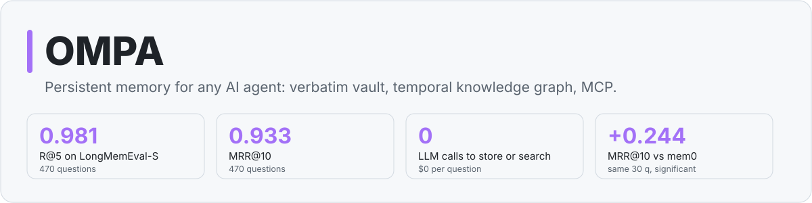
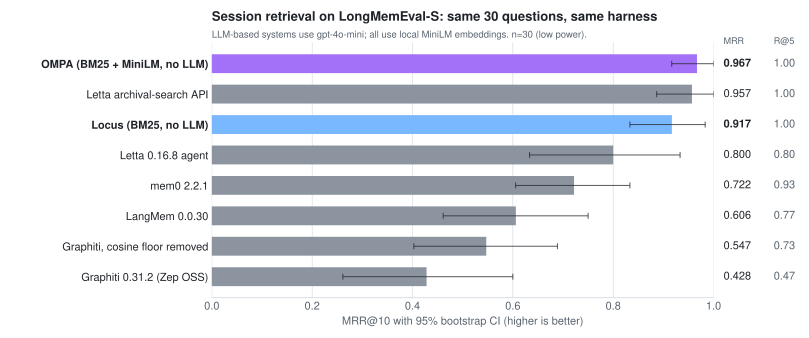
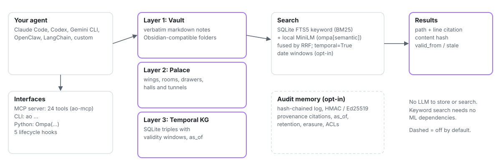
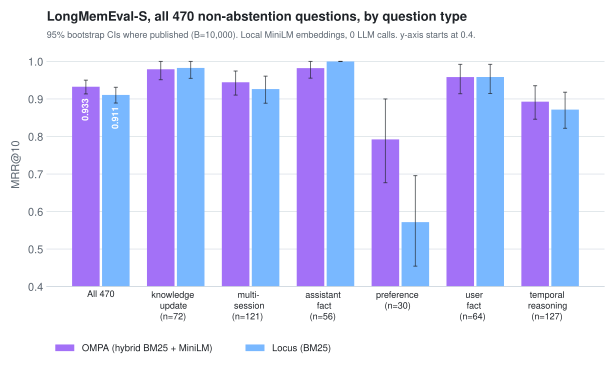
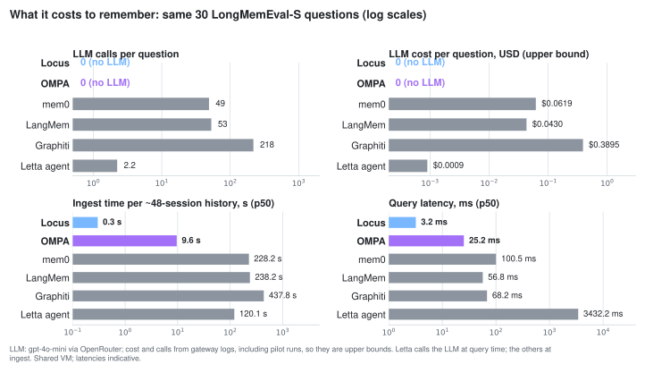

<picture>
  <source media="(prefers-color-scheme: dark)" srcset="https://raw.githubusercontent.com/jmiaie/ompa/main/docs/assets/hero-dark.svg">
  
</picture>

<h3 align="center">Give any AI agent a memory it can cite: verbatim markdown vault, temporal knowledge graph and local hybrid search, served over MCP. No LLM calls to store or search.</h3>

<p align="center">
  <a href="https://github.com/jmiaie/ompa/actions/workflows/ci.yml"></a>
  <a href="https://pypi.org/project/ompa/"></a>
  <a href="https://pypi.org/project/ompa/"></a>
  <a href="https://pypi.org/project/ompa/"></a>
  <a href="https://github.com/jmiaie/ompa/blob/main/LICENSE"></a>
  <a href="https://codecov.io/gh/jmiaie/ompa"></a>
  <a href="https://jmiaie.github.io/ompa/"></a>
  
  <a href="#mcp-server-24-tools"></a>
</p>

---

> **Obsidian-MemPalace-Agnostic** — Give any AI agent persistent memory in one `pip install`.
> Works with Claude Code, OpenClaw, Codex, Gemini CLI, LangChain, or any custom agent.

```bash
pip install ompa
ao init && ao session-start
```

<!-- mcp-name: io.github.jmiaie/ompa -->

Verbatim storage plus local hybrid search (BM25 + embeddings), with no API cost for search. Measured on
the full LongMemEval-S (n=470) with OMPA's benchmark script for 1.1.0: **R@5 0.979** [95% CI 0.964–0.991] for hybrid
search and **0.970** with keyword-only search, which needs no ML dependencies. Method, machine and reproduction steps
are in [`benchmarks/README.md`](https://github.com/jmiaie/ompa/blob/main/benchmarks/README.md). The 2026-11-12
cross-system run, in the same harness as Locus, gives R@5 0.981 and MRR@10 0.933 ([Benchmarks](#benchmarks)).

## Why OMPA?

LLM-memory libraries such as mem0, LangMem and Graphiti call an LLM to extract facts before anything can be searched.
OMPA stores what was said, verbatim, and searches it locally. On the same 30 LongMemEval-S questions, run in one harness:

- **Better ranking.** MRR@10 0.967 vs mem0 0.722, LangMem 0.606 and Graphiti 0.428 (0.547 with its cosine floor
  removed). Every one of these gaps is significant (paired bootstrap).
- **No LLM bill.** 0 LLM calls and $0 per question. In our runs mem0 made 49 calls per question, LangMem 53 and
  Graphiti 218 (gpt-4o-mini, upper bounds from gateway logs).
- **Faster to ingest.** A ~48-session history takes 9.6 s to store and index, against 228 s for mem0, 238 s for
  LangMem and 438 s for Graphiti. A search takes about 25 ms.
- **Citable and auditable.** Search results carry path, line span and content hash; the opt-in audit log is
  hash-chained and tamper-evident.
- **Any agent.** Python API, CLI and a 24-tool MCP server for Claude Code, Codex, Gemini CLI, OpenClaw or your own
  agent.

On the full LongMemEval-S set (470 questions) OMPA reaches **R@5 0.981** and **MRR@10 0.933** at **26 ms** per search.
Method and caveats: [Benchmarks](#benchmarks).

<picture>
  <source media="(prefers-color-scheme: dark)" srcset="https://raw.githubusercontent.com/jmiaie/ompa/main/docs/assets/headtohead-dark.svg">
  
</picture>

<sub>30-question stratified LongMemEval-S subset (low power); open-source libraries with default settings, not the vendors' managed services. Per-question rows and harness: [`benchmarks/published/2026-10-24-headtohead/`](https://github.com/jmiaie/locus/tree/main/benchmarks/published/2026-10-24-headtohead) (in the Locus repo; copies of the rows used for these charts are in this repo).</sub>

### The problem OMPA solves

Every AI agent starts empty every session. Important decisions get lost. Context grows expensive. Summaries lose nuance.

OMPA solves all three:

| Problem | OMPA's Answer |
|---|---|
| Lost decisions | Vault — every significant event persisted as markdown |
| Expensive context | 5 lifecycle hooks with token budgets (~2K at start, ~100 per message) |
| Summarization loss | Verbatim storage; search runs over the full note text ([measured](benchmarks/README.md)) |
| Framework lock-in | Works with any Python agent, any LLM |
| API cost for search | Local SQLite FTS5 (BM25) out of the box; optional local `sentence-transformers` for hybrid search |

---

## Quick Start

**30 seconds, Python 3.10+:**

```bash
pip install ompa
mkdir my-vault && cd my-vault && ao init
python -c "
from ompa import Ompa
ao = Ompa(vault_path='.')
ao.write(content='We decided to use Postgres for sessions.', file_path='work/decisions/postgres.md', date='2026-11-02')
for r in ao.search('Postgres sessions'):
    print(r.path, r.match_type, 'line', r.citation['line_start'])
"
# .../my-vault/work/decisions/postgres.md keyword line 7
# (without ompa[all] it also prints a one-line note that semantic search is off)
```

### 1. Install

```bash
pip install ompa          # Core: keyword (BM25) search, no ML dependencies
pip install "ompa[all]"   # Adds local semantic search for hybrid ranking
```

### 2. Initialize a vault

```bash
ao init              # Create vault structure
ao status            # Verify everything looks good
```

### 3. Use in a session

```bash
ao session-start                              # ~2K token context injection
ao classify "We decided to go with Postgres"  # Routes to right folder automatically
ao search "authentication decisions"          # Local hybrid search (keyword-only without ompa[semantic])
ao kg-query Kai                               # Query the knowledge graph
ao wrap-up                                    # Session summary + save to vault
```

### 4. Python API

```python
from ompa import Ompa

ao = Ompa(vault_path="./workspace")

# Lifecycle
context = ao.session_start().output       # ~2K-token context string (HookResult.output)
hint = ao.handle_message("We won the enterprise deal!")
ao.post_tool("write", {"file_path": "work/active/auth.md"})
ao.stop()

# Search (hybrid BM25 + semantic; BM25 only without ompa[semantic])
results = ao.search("authentication decisions", wing="Orion")

# Knowledge graph
ao.kg.add_triple("Kai", "works_on", "Orion", valid_from="2025-06-01")
triples = ao.kg.query_entity("Kai")
timeline = ao.kg.timeline("Orion")

# Palace navigation
ao.palace.create_wing("Orion", type="project")
ao.palace.create_tunnel("Kai", "Orion", "auth-migration")
```

### 5. Date-aware ranking (opt-in, off by default)

```python
ao.write(content=transcript, file_path="work/chats/2023-05-20.md", date="2023-05-20")  # when it happened (default: today)
ao.search("what did I buy two weeks ago?", temporal=True, reference_date="2023-05-30")
ao = Ompa(vault_path="./workspace", temporal_ranking=True)    # or make it the default
```

Point-in-time phrases ("3 weeks ago", "last Tuesday", "yesterday", "last weekend", "last week", "last month") are resolved against `reference_date` (default: today). Notes whose frontmatter `date` falls in that window are boosted by reciprocal rank fusion. Duration ranges ("past few months") and windows wider than 45 days are ignored. Undated notes are never boosted, and there is no general recency boost. A query without such a phrase returns exactly the normal ranking.

**Measured on LongMemEval-S** (470 questions, session retrieval, paired bootstrap): the overall effect is small and **not significant** (MRR 0.932 → 0.935, +0.003 [−0.006, +0.012]). On **temporal-reasoning questions** (n=127) it is **significant**: 0.893 → 0.918, +0.025 [+0.002, +0.053]. Multi-session (−0.008) and single-session-user (−0.014) dip slightly; neither change is significant. It adds no measurable latency. See [`benchmarks/published/2026-11-12-temporal/`](benchmarks/published/2026-11-12-temporal/README.md).

---

## Three-Layer Architecture

<picture>
  <source media="(prefers-color-scheme: dark)" srcset="https://raw.githubusercontent.com/jmiaie/ompa/main/docs/assets/architecture-dark.svg">
  
</picture>

```
┌───────────────────────────────────────────────────────────────┐
│  Layer 1: Vault  (human-navigable markdown)                   │
│  brain/  work/  org/  perf/  ← obsidian-mind structure        │
├───────────────────────────────────────────────────────────────┤
│  Layer 2: Palace  (agent-accessible metadata)                 │
│  wings → rooms → drawers  (vault file references)             │
│  halls: facts · events · discoveries · preferences            │
│  tunnels: cross-wing connections                              │
├───────────────────────────────────────────────────────────────┤
│  Layer 3: Knowledge Graph  (temporal triples)                 │
│  SQLite: subject → predicate → object + validity window       │
│  Query any entity's history at any point in time              │
└───────────────────────────────────────────────────────────────┘
```

---

## Features

### 5 Lifecycle Hooks

| Hook | Token Budget | Fires When |
|------|-------------|------------|
| `session_start` | ~2,000 | Session begins — full context injection |
| `user_message` | ~100 | Each incoming user message |
| `post_tool` | ~200 | After each tool call |
| `pre_compact` | ~100 | Before context compaction |
| `stop` | ~500 | Session ends — wrap-up and persist |

### 15 Message Types

Auto-classified and routed to the right vault folder:

`DECISION` · `INCIDENT` · `WIN` · `LOSS` · `BLOCKER` · `QUESTION` · `SUGGESTION` · `REVIEW` · `BUG` · `FEATURE` · `LEARN` · `RETROSPECTIVE` · `ALERT` · `STATUS` · `CHORE`

```bash
ao classify "We decided to go with Postgres over MySQL"
# → MessageType.DECISION → vault/work/decisions/2026-05-07-postgres.md
```

### MCP Server (24 Tools)

Plug directly into **Claude Desktop, Cursor, or Windsurf** with one command:

```bash
claude mcp add ompa -- python -m ompa.mcp_server
# or pin the vault with the installed console script
claude mcp add ompa -e OMPA_VAULT_PATH=/path/to/vault -- ao-mcp
```

| Tool | Description |
|------|-------------|
| `ao_session_start` | Inject full memory context (~2K tokens) |
| `ao_classify` | Route a message to the right vault folder |
| `ao_search` | Hybrid keyword + semantic search across vault |
| `ao_kg_query` | Query knowledge graph for an entity |
| `ao_kg_add` | Add a triple to the knowledge graph |
| `ao_kg_stats` | Knowledge graph statistics |
| `ao_palace_wings` | List all wings |
| `ao_palace_rooms` | List rooms in a wing |
| `ao_palace_tunnel` | Create/traverse cross-wing tunnel |
| `ao_validate` | Validate vault structure |
| `ao_wrap_up` | Session summary + persist |
| `ao_status` | Vault health status |
| `ao_orphans` | Detect orphaned notes |
| `ao_init` | Initialize a new vault |
| `ao_write` | Write a note (indexed, KG-extracted, audited) |
| `ao_kg_populate` | Extract facts from notes into the KG |
| `ao_sync` | Sync the vault (git / rsync / S3) |
| `ao_export` / `ao_import` | Move notes between personal and shared vaults |
| `ao_audit_verify` | Verify the tamper-evident audit chain (+ note drift) |
| `ao_audit_head` | Current chain head, for external anchoring |
| `ao_audit_export` | Exportable JSON evidence bundle |
| `ao_forget` | Right-to-erasure (dry run by default) |
| `ao_as_of` | What the agent knew at time T |

### Audit Memory (opt-in)

Tamper-evident, hash-chained audit log of every memory mutation, with Merkle
checkpoints, optional Ed25519/HMAC signing and exportable evidence bundles.
Also: citations (path, line/byte span, content hash, author, recorded and valid
time) on search and KG results, `as_of(t)` point-in-time views, retention TTLs,
legal hold, right-to-erasure with proof of deletion, and per-vault ACLs.
Stdlib-only (`pip install ompa[audit]` adds Ed25519). Off by default.

```python
ao = Ompa(vault_path="./vault", audit=True, principal="agent-7")
ao.search("Orion budget")[0].citation
ao.audit_verify()["ok"]
```

See [docs/AUDIT.md](docs/AUDIT.md) for the threat model, the guarantees and
non-guarantees, migration and a compliance mapping (supports, not certifies).

### Dual-Vault Mode

Isolate team/org content from personal or private notes:

```python
from ompa import Ompa, DualVaultConfig, IsolationMode

config = DualVaultConfig(
    shared_vault="./team-vault",
    personal_vault="./private-vault",
    mode=IsolationMode.AUTO,
)
ao = Ompa(config=config)
```

---

## Benchmarks

### Full LongMemEval-S (470 questions)

| System | R@5 [95% CI] | R_all@5 | MRR@10 [95% CI] | Search p50 | Ingest p50 per history | LLM calls |
|---|---|---|---|---|---|---|
| **OMPA** (hybrid BM25 + MiniLM) | **0.981** [0.968, 0.992] | 0.877 | **0.933** [0.913, 0.950] | 26 ms | 10.1 s | 0 |
| Locus (BM25) | 0.977 [0.962, 0.989] | 0.860 | 0.911 [0.889, 0.931] | 2.3 ms | 0.22 s | 0 |

<picture>
  <source media="(prefers-color-scheme: dark)" srcset="https://raw.githubusercontent.com/jmiaie/ompa/main/docs/assets/by-type-dark.svg">
  
</picture>

Session-level retrieval on the 470 non-abstention questions of `longmemeval_s_cleaned.json` (about 48 sessions per
history), both systems in one harness on 2026-11-12. R@5: an answer session is in the top 5. R_all@5: every answer
session is in the top 5. 95% CIs are percentile bootstrap, B=10,000, seed 20261020. Local `all-MiniLM-L6-v2`
embeddings, CPU only, shared VM, so latencies are indicative. OMPA's MRR lead over Locus (+0.022) is significant and
comes almost entirely from preference questions. Summary: [`2026-11-12-lme500/`](https://github.com/jmiaie/ompa/tree/main/benchmarks/published/2026-11-12-lme500). OMPA's own
benchmark script, run for 1.1.0, gives R@5 0.979 for hybrid and 0.970 keyword-only (below); both runs agree within
their CIs.

### Cost and speed against LLM-memory libraries

<picture>
  <source media="(prefers-color-scheme: dark)" srcset="https://raw.githubusercontent.com/jmiaie/ompa/main/docs/assets/efficiency-dark.svg">
  
</picture>

Same 30-question subset and harness as the chart above. mem0, LangMem and Graphiti call the LLM at ingest; Letta's
agent calls it at query time. Cost and call counts come from our gateway logs and include pilot runs, so they are
upper bounds.

### About vendors' published numbers

mem0 reports 94.4% on LongMemEval and Zep reports 90.2%. Those are **end-to-end answer accuracy**: a reader LLM
answers from the retrieved memories and a judge LLM grades the answer, with each vendor's own models and managed
service. The numbers here are **retrieval recall and ranking** with no reader and no judge. They measure different
things and **cannot be compared directly**: high recall is necessary for a correct answer but does not guarantee one.
Sources: [`published_competitors.md`](https://github.com/jmiaie/ompa/tree/main/benchmarks/published/2026-11-12-lme500/published_competitors.md).

### Benchmarks at a glance

| What | Result | Data / n |
|---|---|---|
| LongMemEval-S R@5 (session retrieval) | hybrid **0.979** [0.964, 0.991]; keyword-only **0.970** [0.953, 0.985] | 470 questions |
| Search latency, hybrid p50 (vs 1.0.8) | 1k: 17.4 → **2.1 ms** · 10k: 185 → **9.4 ms** · 50k: 1,061 → **44 ms** (8–24× faster) | synthetic notes, stub embedder |
| Temporal KG point-in-time accuracy (vs 1.0.8) | 0.895 → **1.000** | 20-seed Monte Carlo, 400 queries/seed |
| Audit log tamper detection | unsigned **24,998 / 24,998**, HMAC **25,000 / 25,000**, 0 false positives | randomized tamper Monte Carlo, 5 seeds |
| Full-chain rewrite (no key) | detected **only** against an external anchor (1,500 / 1,500 with, 0 / 1,500 without) | by design; see [docs/AUDIT.md](docs/AUDIT.md) |
| Audit write overhead | +0.50 ms p50 per write (unsigned), +0.84 ms (Ed25519) | 900 writes/mode |
| Head-to-head vs LLM-memory systems (LME-S session retrieval, same questions; LLM `gpt-4o-mini`, MiniLM embeddings) | OMPA R@5 **1.000**, MRR **0.967**; Locus 1.000 / 0.917; mem0 2.2.1 0.933 / 0.722 (ΔMRR vs OMPA −0.24, sig.); LangMem 0.767 / 0.606 (−0.36, sig.). OMPA uses no LLM at ingest or query; mem0/LangMem spend ~4 min and 4–6¢ of LLM per 48-session haystack. Letta 0.16.8 (n=30): agent R@5 0.800, MRR 0.800 (ΔMRR vs OMPA −0.17, sig.); its direct archival-search API 1.000 / 0.957 (−0.01, ns: tied). Zep (Graphiti OSS 0.31.2, n=30): R@5 0.467, MRR 0.428 (ΔMRR vs OMPA −0.54, sig.; ~$0.39 + 7 min of LLM per haystack); same graph with the cosine floor removed 0.733 / 0.547 (−0.42, sig.). Graphiti on Gemini `gemini-3.5-flash-lite`, minimal reasoning (free tier, n=30, $0; different LLM, not directly comparable to the gpt-4o-mini rows): R@5 0.167, MRR 0.167 (ΔMRR vs OMPA −0.80, sig.); floor removed 0.367 / 0.295 (−0.67, sig.). Separate setting, label `gemini-3.5-flash-lite, reasoning high; different LLM setting, not directly comparable` (n=30 unique questions, 0 ingest errors, $0): default R@5 0.500, MRR 0.467, 1/30 empty searches (minimal was 19/30); floor removed R@5 0.633, MRR 0.539. Paired bootstrap vs Graphiti `gpt-4o-mini`, B=10,000, seed 20261020: MRR p=0.7622 default and p=0.9324 floor removed (no significant difference, and not evidence of equivalence). Vs minimal Gemini: MRR p=0.0026 default and p=0.0054 floor removed (significant). | 30-question stratified subset (low power) |

Latencies come from a shared VM and are indicative. Head-to-head method, per-question results and harness:
[locus `benchmarks/published/2026-10-24-headtohead/`](https://github.com/jmiaie/locus/tree/main/benchmarks/published/2026-10-24-headtohead)
(OMPA main `34d533e`, hybrid search with MiniLM). The minimal Gemini rows are
`results/lme30__graphiti_gemini.jsonl` and `summary_graphiti_gemini.json` in that tree.
The high-reasoning rows are not published there yet.

The high-reasoning label is a different LLM setting from both the `gpt-4o-mini` Graphiti rows and the minimal-reasoning Gemini rows. Default search was nonempty for 29 of 30 questions; 29/30 means the search returned something, not that the answer was correct (an answer session is in the top 5 for 15/30, R@5 0.500). No significant MRR difference versus `gpt-4o-mini` is not evidence the settings are equivalent (n=30, wide intervals). Extraction diagnosis, from prior diagnostic notes and not a fresh recomputation: minimal reasoning produced empty fact extraction on 74% of episodes (1,070/1,455 haystack sessions) versus 1% (16/1,454) for `gpt-4o-mini`.

---

## Companion stack

OMPA is the **memory + temporal KG** layer. For retrieval and compliance, pair it with:

| Layer | Project | Role |
|---|---|---|
| Memory schema | **OMPA** ([PyPI](https://pypi.org/project/ompa/)) | Vault · palace · temporal KG · MCP · lifecycle hooks |
| Explainable retrieval | **[Locus](https://github.com/jmiaie/locus)** ([`locus-rag`](https://pypi.org/project/locus-rag/)) | Vectorless RAG — BM25 + KG + link walking, zero GPU |
| Compliance product | **[CognitionOS](https://github.com/jmiaie/cognition-os)** | Audit · RBAC · retention · PHI redaction on top of Locus + OMPA |

**Consulting one-pager:** [Why OMPA vs raw Obsidian?](docs/why-ompa.md)

---

## CLI Reference

```
ao init              Initialize a new vault
ao status            Health check and stats
ao session-start     Inject memory context (use at session start)
ao classify <msg>    Classify and route a message
ao search <query>    Hybrid search (BM25 + semantic)
ao orphans           Detect orphaned notes
ao wrap-up           Session summary and save
ao wings             List palace wings
ao rooms <wing>      List rooms in a wing
ao tunnel            Create/traverse cross-wing tunnel
ao kg-query <entity> Query knowledge graph
ao kg-timeline <e>   Entity timeline
ao kg-stats          Knowledge graph statistics
ao validate          Validate vault structure
ao rebuild-index     Rebuild the search indexes
ao audit …           enable | verify | head | log | export | verify-bundle | keygen | as-of
ao forget <subject>  Right-to-erasure with a tombstone in the audit chain
ao retention …       add | list | apply | remove   (TTL rules)
ao hold …            add | release                 (legal hold)
ao acl …             init | show                   (vault access control)
```

---

## Framework Compatibility

| Agent Framework | Integration Method |
|---|---|
| Claude Code | Python API + MCP server |
| OpenClaw | Python API + MCP server |
| Codex | Python API + MCP server |
| Gemini CLI | Python API + MCP server |
| LangChain | Python API |
| Custom agents | Python API |

---

## Comparison

| Feature | **OMPA** | MemPalace | obsidian-mind |
|---|---|---|---|
| Framework support | **Any** | Claude Code only | Claude Code only |
| Memory layers | **Vault + Palace + KG** | Palace + KG | Vault only |
| Search | **Local BM25 + optional local embeddings (free)** | ChromaDB API | QMD (paid) |
| Temporal KG | **SQLite ✓** | SQLite ✓ | ✗ |
| MCP server | **24 tools** | 15 tools | ✗ |
| CLI | **40 commands** | ✗ | ✗ |
| Lifecycle hooks | **5** | 3 | 3 |
| Message types | **15** | 15 | 5 |
| Verbatim storage | **✓** | ✓ | ✗ |
| Multi-agent | **✓** | ✗ | ✗ |
| Dual-vault isolation | **✓** | ✗ | ✗ |

<sub>OMPA's column is checked against this repo. The other columns come from those projects' docs when the table was written and have not been re-verified.</sub>

---

## Installation Options

```bash
# Core (vault + palace + KG + CLI + MCP server)
pip install ompa

# With local semantic + hybrid search (adds sentence-transformers + numpy).
# Keyword (BM25) search over note content works without it.
pip install ompa[all]

# Development
pip install ompa[dev]

# From source
git clone https://github.com/jmiaie/ompa && cd ompa
pip install -e ".[all]"
```

Requires Python 3.10+.

---

## Package Structure

```
ompa/
├── core.py              # Ompa main class — lifecycle, hooks, dual-vault
├── vault.py             # Vault management (brain/work/org/perf)
├── palace.py            # Palace metadata (wings/rooms/drawers/halls/tunnels)
├── knowledge_graph.py   # Temporal KG (SQLite triples + validity windows)
├── hooks.py             # 5 lifecycle hooks + HookManager
├── classifier.py        # 15 message types with auto-routing
├── semantic.py          # Semantic index (resident float16 matrix) + RRF hybrid
├── keyword.py           # BM25 keyword index (stdlib SQLite FTS5)
├── audit.py             # Hash-chained audit log, Merkle checkpoints, signing, bundles
├── governance.py        # ACL, retention, legal hold, forget(), as_of views
├── provenance.py        # Citations for search / KG results
├── mcp_server.py        # MCP protocol server (24 tools)
├── config.py            # Dual-vault configuration
└── cli.py               # typer CLI (40 commands)
```

---

## Use cases

- **Coding agents that remember.** Decisions, incidents and preferences from Claude Code or Codex sessions land in a
  markdown vault you can open in Obsidian, and come back at the next `session-start`.
- **Multi-agent teams.** Shared and personal vaults with isolation (dual-vault mode) and per-agent provenance.
- **Point-in-time answers.** The temporal KG answers "who owned Orion in June?" and `as_of(t)` shows what the agent
  knew at a given moment.
- **Regulated work.** The opt-in audit log, retention, legal hold, right-to-erasure and ACLs support evidence
  requirements ([docs/AUDIT.md](https://github.com/jmiaie/ompa/blob/main/docs/AUDIT.md); supports, does not certify).
- **Explainable retrieval on top.** Pair with [Locus](https://github.com/jmiaie/locus) for BM25 + KG retrieval with
  per-result explanations.

---

## Roadmap

From [`docs/ROADMAP.md`](https://github.com/jmiaie/ompa/blob/main/docs/ROADMAP.md); dates are not commitments.

- **Now:** MCP Registry listing; documenting or implementing `OMPA_ENABLE_SEMANTIC` / `OMPA_AGENT_NAME`.
- **Next:** Locus reads OMPA's KG through the v1 schema contract; a one-page bundle install guide; Smithery and
  PulseMCP listings; a LongMemEval-S re-run with every release.
- **Later:** kg-schema v2 with vault-relative paths and a migration; latency targets for MCP calls.
- **Measured headroom:** questions that need several sessions at once (R_all@5 0.785 on multi-session, 0.787 on
  temporal) are the largest remaining gap on LongMemEval-S.
- **Not planned:** a hosted memory service, or GPU / vector-database backends in core.

---

## Credits & Attribution

OMPA is a synthesis of ideas from the AI agent memory community:

- **[MemPalace](https://github.com/corbt/mem_palace)** by Kyle Corbitt — palace metaphor (wings/rooms/drawers), temporal KG design, and verbatim storage approach
- **[obsidian-mind](https://github.com/obsidian-ai/obsidian-mind)** — vault structure (brain/work/org/perf), wikilink conventions, frontmatter validation, session lifecycle patterns
- **Claude Code / Anthropic** — hook patterns and agent-tool interaction models
- **OpenClaw** — framework-agnostic agent runtime that inspired the "universal" design goal

---

## License

MIT — [Micap AI](https://micap.ai)
